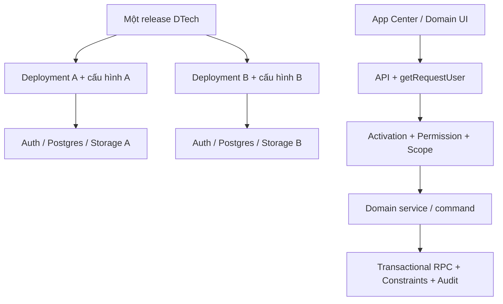

# Kiến trúc đích và ADR-001

**ADR-001 — Chấp nhận single-tenant deployment first.** Chọn modular monolith Next.js/React/TypeScript/Supabase. Không thêm `tenant_id` rời rạc hoặc trộn hai khách hàng vào DB hiện tại.

Hiện thực: `src/app`, `src/features`, `src/services`, `src/components/shared`; migrations ở `supabase/migrations`. `getRequestUser` thu hẹp quyền theo capability; domain service vẫn phải kiểm tra scope và trạng thái vì service-role bypass RLS.

Operator console khởi đầu bằng CLI/deployment metadata. Chưa có operator portal, licensing hoặc membership SaaS. Multi-tenant shared DB là dự án migration riêng có kiểm thử cách ly toàn data path.

Tương thích: giữ URL/API hiện tại; redirect bookmark Dashboard cũ. Brand đã lưu của khách hàng ưu tiên default mới; không cập nhật hàng loạt `system_settings` trên DB khách hàng.
