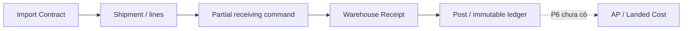

# Ma trận chu trình ERP

| Chu trình | Hiện trạng và source | Thiếu để đóng chu trình |
| --- | --- | --- |
| Hire-to-Pay | employees → attendance/leave → timesheets → accounting payroll/payslip | Atomic lifecycle, chính sách doanh nghiệp, đối soát và UAT kế toán |
| Import-to-Receive | import-export service + shipment RPC → warehouse receipt/ledger | UAT nhận từng phần/đồng thời; landed cost và AP chưa có |
| Procure-to-Pay | Vendor/partner và warehouse có thể tái sử dụng | PR, PO, supplier invoice/AP/payment chưa có |
| Order-to-Cash | Warehouse/document/partner core có thể tái sử dụng | CRM/customer, quote, sales order, delivery/AR chưa có |
| Project-to-Cost | Project/team/progress, stock source references, field attendance | Budget/actual allocation, expenses, billing và profitability chưa đầy đủ |
| Manufacturing/garment | Preset chọn capability hiện có | BOM, MRP/work orders, chuyền may, QC, costing chưa có |

Mỗi slice mới phải giữ source ID/correlation, state transitions, scope, concurrency, audit và ledger reconciliation. Payroll không phải sổ cái; hợp đồng nhập khẩu không thay thế purchasing.
