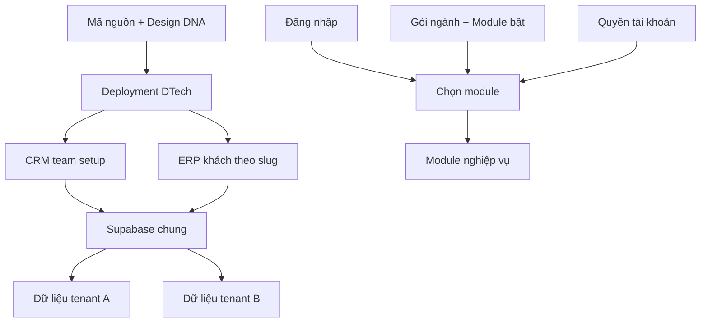

# Nền tảng DTech ERP

## Triển khai theo doanh nghiệp

Theo yêu cầu 23/10/2026, khách mới dùng chung project Supabase của DTech, tách dữ liệu và tài khoản theo doanh nghiệp bằng `tenant_id`. Một dòng mã nguồn, DNA và cấu hình gói ngành dùng chung. Xem [kiến trúc hiện hành](shared-project-architecture.md).

ERP nội bộ và các bản cài riêng cũ giữ dữ liệu/truy vấn hiện hữu. Khách mới chỉ truy cập `/erp/[slug]` và các RPC business có kiểm tra phiên/tenant; không đưa tài khoản khách vào truy vấn service role toàn cục của ERP nội bộ. Các migration business cần rollout riêng trước khi cấp khách thật.

## Thiết lập khách hàng

Với mô hình tenant: tạo/lưu hồ sơ CRM → Cấp dùng thử → chọn gói ngành/module → nhận địa chỉ `/erp/[slug]/login` và thông tin bàn giao → khách đổi mật khẩu lần đầu → khai báo danh mục và vận hành. Gia hạn, kích hoạt, tạm ngừng và reset owner thực hiện từ hồ sơ khách. [Luồng bán hàng–giao hàng–kho](sales-fulfillment.md) dùng session business và command nguyên tử.

Các bước bên dưới mô tả bản cài riêng cũ và thiết lập ERP nội bộ; wizard `/system-admin/setup` không cấu hình tenant khách mới.

1. Tạo manifest khách hàng từ mẫu, chạy validate/plan local và review target theo [hướng dẫn](../commercial-erp/deployment-manifest-guide.md). Tạo deployment và Supabase riêng, cấu hình môi trường, áp dụng migrations/customer settings và bootstrap admin theo runbook.
2. Đăng nhập → **Thiết lập ERP** → **Doanh nghiệp**: tên pháp lý, tên viết tắt, mã số thuế, liên hệ.
3. **Thương hiệu**: tên hệ thống/logo khách hàng. Không có logo thì dùng chữ viết tắt, không hiển thị logo khách hàng khác.
4. **Giao diện**: màu chính, mật độ. **Design DNA**: xem component theo thương hiệu hiện tại. Thiết lập **Mẫu phiếu lương** theo tên pháp lý doanh nghiệp.
5. **Thiết lập ERP**: chọn ngành → áp dụng gói → điều chỉnh từng module → lưu. Áp dụng gói chỉ đổi bản nháp; lưu mới công bố. Ngành và flags lưu nguyên tử trong cùng nhóm `modules`.
6. Cấp role/tài khoản; thiết lập phòng ban, ca, kho, chính sách và luồng duyệt. Bật module không tự cấp quyền hay tạo dữ liệu.
7. Nhập/đối soát dữ liệu, nghiệm thu nghiệp vụ, kiểm tra backup/restore và bàn giao.

Wizard `/system-admin/setup` gộp Doanh nghiệp, Thương hiệu, Module và Xác nhận. Bản nháp trình duyệt có thể tiếp tục; xuất bản bốn group qua command nguyên tử với baseline versions/request ID. CLI có reviewed activation plan cho operator. Xem [hướng dẫn](../commercial-erp/customer-activation-guide.md); DTech development đã có migration, các bản cài khác cần rollout/rehearsal riêng.

Màn đăng nhập chỉ có nhận diện doanh nghiệp và form, không liệt kê module. `/` và đăng nhập thành công trên desktop/điện thoại đều đến `/applications`. Gateway chỉ hiện ứng dụng được bật và có quyền, dùng thẻ pastel theo nghiệp vụ và tìm tiếng Việt không dấu; không có bộ lọc nhóm hoặc module Dashboard độc lập. Trong module, menu chỉ chứa nghiệp vụ thuộc module đó và có lối quay lại “Tất cả module”; không lặp dãy “Ứng dụng của tôi”.

## Phạm vi hiện có

| Capability | Phạm vi |
| --- | --- |
| Nhân sự | Hồ sơ, phòng ban, chức vụ, hợp đồng, bảo hiểm |
| Chấm công & Nghỉ phép | Cá nhân/quản trị, ca, kỳ công, đơn và chính sách phép |
| Dự án & Công trường | Gói/công trường, tiến độ, phân công, điểm danh, vấn đề |
| Kho & Vật tư | Danh mục, nhập/xuất/chuyển, tồn, kiểm kê, điều chỉnh, sổ kho |
| Xuất nhập khẩu | Hợp đồng, lô hàng, vận chuyển, hồ sơ, hải quan |
| Lương & Thu nhập | Dữ liệu lương, bảng lương, phiếu lương; chưa phải kế toán tổng hợp |
| Phê duyệt & Tài liệu | Hộp duyệt, ủy quyền và tài liệu |
| Báo cáo | Báo cáo đã đăng ký |
| Tin nhắn | Trao đổi nội bộ |

Ứng dụng có thể gom nhiều capability: Nhân sự chứa quản trị công, Điều hành gom phê duyệt/tài liệu/báo cáo. Tắt một capability vẫn giữ các phần còn được cấp quyền. Nền tảng tài khoản và quản trị luôn tồn tại để khôi phục cấu hình.

## Cơ chế cấu hình

- `erpRegistry.json`: nguồn capability/catalog/gói ngành dùng chung cho UI và CLI. `erpModules.ts` xuất API TypeScript và ánh xạ quyền/API.
- `systemSettings.ts`: schema boolean và `industryPreset`; lưu trong `system_settings` với phiên bản/audit hiện hữu. JSON mới không cần migration database. Flag mới optional để giữ cấu hình cũ khi nâng cấp.
- Giá trị mặc định trong mã nguồn dùng nhận diện DTech. Thương hiệu đã lưu trong database của khách hàng vẫn được ưu tiên khi nâng cấp.
- `moduleRegistry.ts`: ứng dụng, icon, route và quyền. Điều hướng và launcher đều dùng registry.
- `getRequestUser`: thu hẹp quyền theo module. Proxy ghi đè đường dẫn thực; API của module tắt trả 403 kể cả khi một quyền liên module cũng mở được API đó.
- Tắt module không xóa dữ liệu và không sửa role gốc. Bật lại vẫn cần quyền ban đầu. Sau lưu, giao diện refresh dữ liệu người dùng.
- Cache cấu hình giữa worker có TTL 30 giây; worker ghi cập nhật snapshot ngay. Thu hồi quyền/session vẫn là cơ chế khóa tài khoản tức thời.
- Cache hết hạn phải xác minh lại qua Supabase. Lỗi/timeout hoặc group module không hợp lệ trả 503 cho strict reader, không dùng default bật module. Layout/login có fallback hiển thị tắt mọi module; fallback không cấp quyền.
- Worker tích hợp, cron và service key cần cấu hình riêng khi bàn giao. Chặn API phiên đăng nhập không tự dừng tác vụ nền.

## Hoàn thiện ERP theo chu trình

| Chu trình cần bổ sung | Các bước |
| --- | --- |
| Bán hàng | CRM → báo giá → đơn hàng → giao hàng → hóa đơn/công nợ |
| Mua hàng | Yêu cầu mua → duyệt → PO → nhận hàng → đối chiếu công nợ |
| Sản xuất | BOM phiên bản → kế hoạch/MRP → lệnh → cấp vật tư → WIP/sản lượng → nhập thành phẩm |
| Tài chính | Tài khoản, chứng từ cân đối, kỳ, phải thu/trả, tiền mặt/ngân hàng, thuế, giá thành, báo cáo tài chính |
| May mặc | Mã hàng/màu/size, định mức NPL, chuyền may, QC, gia công, lương sản phẩm |

Gói May mặc hiện chọn HR, chấm công, kho, XNK, lương, phê duyệt/tài liệu, báo cáo, tin nhắn; tắt công trường. Sản xuất may được ghi “Chưa triển khai”. Không coi gói cấu hình này là ERP sản xuất hoàn chỉnh.

Mỗi chu trình bổ sung cần liên kết chứng từ, kiểm soát trạng thái, đảo giao dịch, quyền, audit và nghiệm thu trước khi công bố module.
